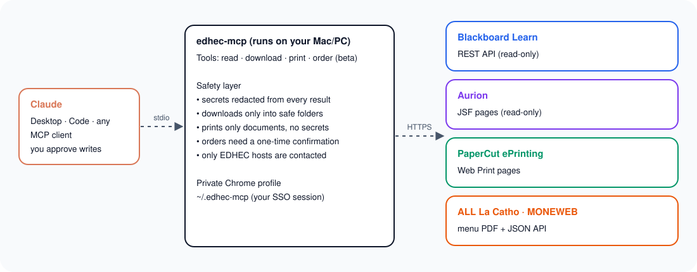

<div align="center">

# edhec-mcp

[](LICENSE)
[](https://modelcontextprotocol.io)
[](package.json)
[](test/security.test.js)
[](#is-this-an-official-edhec-tool)

**An unofficial MCP server that connects Claude to Blackboard, Aurion, PaperCut ePrinting and the campus restaurant.**
Ask for your timetable, download a whole course, print a case stapled or check today's menu, in one sentence.
It runs on your own computer and signs in with your normal EDHEC Microsoft login. It never sees your password.



[Install in one message](#install-in-one-message) · [What you can ask](#what-you-can-ask) · [All tools](#all-tools) · [Absences](#absences-at-edhec) · [Security](#security-and-privacy) · [FAQ](#faq)

</div>

---

## Install in one message

**No terminal needed.** Copy the message below and paste it into Claude. Claude installs everything, and you only sign in with your EDHEC account at the end.

> **Where to paste it:** in the **Claude desktop app, open the *Code* tab** (or use Claude Code, Cursor or any AI agent that can work on your computer). The normal chat can't install software.

```text
Please install the edhec-mcp server for me:
https://github.com/Sillvs/edhec-mcp

1. Check that Node.js 20 or newer and Google Chrome are installed.
   If one is missing, give me the download link, explain it in
   simple words and wait until I'm done.
2. Download the project into a folder called "edhec-mcp" in my
   home folder (if it already exists, update it with git pull).
   Run "npm ci" and "npm test" there and make sure all tests pass.
3. Add it as an MCP server named "edhec" with the full path to
   src/index.js. For Claude Code use:
   claude mcp add --scope user edhec -- node <full path>/src/index.js
   If I also use the Claude Desktop chat, add it to
   claude_desktop_config.json under "mcpServers" too
   (make a backup first and keep my other servers).
4. Run "npm run login" in that folder. A Chrome window opens and
   I will sign in with my EDHEC account myself.
   Never ask me for my password.
5. When it's done, tell me to restart Claude and give me three
   things I can ask, e.g. about my timetable, my courses and
   today's lunch menu.
```



<details>
<summary><b>Update or remove it later</b> (also one message)</summary>

**Update:**

```text
Update my edhec-mcp server: in the edhec-mcp folder in my home
folder run "git pull", "npm ci" and "npm test", then tell me
to restart Claude.
```

**Signed out?** Just ask Claude *"Sign me in to EDHEC again"*. It opens the sign-in window for you.

**Remove:**

```text
Remove the edhec-mcp server: run
"claude mcp remove --scope user edhec", remove "edhec" from
claude_desktop_config.json if it is there, then delete the
"edhec-mcp" and ".edhec-mcp" folders in my home folder.
```

</details>

Prefer to do it by hand? See the [manual setup](#manual-setup).

---

## What it is

**edhec-mcp** is a [Model Context Protocol](https://modelcontextprotocol.io) (MCP) server for **EDHEC Business School** students. MCP is the standard way to give AI assistants like Claude new tools. Once you add this server, Claude can work with the four systems you use every week:

| | System | What Claude can do with it |
|---|---|---|
|  | **Blackboard Learn** (learning.edhec.edu) | List courses, read content and announcements, download all files, see grades and deadlines |
|  | **Aurion** (aurion.edhec.edu) | Timetable with rooms, grades, absences and absence reports, free rooms right now, school certificate PDF |
|  | **PaperCut ePrinting** (eprinting.edhec.edu) | Print A4, A3 or stapled, check your print quota, cancel jobs |
|  | **Campus food** (ALL La Catho · MONEWEB) | Today's menu, card balance and history, snack-corner pre-orders *(beta)* |

---

## What you can ask

Every animation below is a mockup with **fictional sample data**. The tool names are the real ones.

### "What do I have tomorrow?"



Claude reads your **Aurion** timetable and your **Blackboard** deadlines in one go, so you get rooms, teachers and due dates in one answer.

### "Download the whole course"



Every attachment lands in a clean folder structure (one folder per session). Harvard course-pack links are listed, never scraped.

### "Print it, stapled"


Jobs wait in the queue until you tap your card at any campus printer. Claude checks your quota and can cancel a job you no longer need.

### "What's for lunch, and can I afford it?"



The menu is published as a PDF. The server hands Claude the pages as images, so Claude reads dishes and prices itself and compares them with your card balance.

### "Pre-order from the snack corner" *(beta)*



Ordering always takes **two steps**. Claude first shows the items, the total (the student formula is €1.00 once per day), your balance afterwards and where to pick it up. Nothing is booked or paid until you say yes to that exact summary. The snack corner (Le Break, building R) takes orders on the same day from 6:00 to 10:00; pickup is 11:30 to 14:00 with your student card. Paid orders cannot be cancelled.

### "I was sick, what do I do?"



Claude checks whether an assessment was scheduled, how much of the 48-hour window is left and whether a proof is already on file. It then prepares the report with **your own words and your own document** and sends it to the HUB Front Office only after you confirm. [How absences work at EDHEC](#absences-at-edhec)

### "Admin stuff, done"



Check absences before they cost you points, and get your *certificat de scolarité* as a PDF for your bank, landlord or visa.

---

## Prompt cookbook

Copy any of these into Claude once the server is [installed](#install-in-one-message).

<details open>
<summary><b>Daily routine</b></summary>

- *What's on my timetable today, and which rooms are free near my next class right now?*
- *Do I have anything due in the next 10 days across all my courses?*
- *What did the professors announce this week? Summarise in five bullets.*
- *What's for lunch at the EDHEC restaurant today and how much is left on my card?*

</details>

<details>
<summary><b>Before a session or quiz</b></summary>

- *Download everything for Session 3 of my M&A course into ~/Documents/EDHEC/M&A.*
- *Read the case for tomorrow and give me the 20 facts most likely to come up in a multiple-choice quiz.*
- *Turn the self-study questions from the syllabus into short answer outlines.*
- *Print the case stapled and the summary on A4.*

</details>

<details>
<summary><b>Exam period</b></summary>

- *List every graded item in all my courses with points and due dates.*
- *Show my grades and any resit sessions.*
- *Do I have absences that could affect my grade? Which ones still need a proof?*
- *I missed today's quiz because I was sick. Here is my doctor's note: ~/Downloads/note.pdf. Prepare the absence report.*

</details>

<details>
<summary><b>Admin</b></summary>

- *Download my school certificate into ~/Documents/Admin.*
- *Which groups and optional courses am I registered in?*
- *Get the academic calendar for this year.*

</details>

<details>
<summary><b>Campus food</b></summary>

- *Show my last 10 purchases with the campus card.*
- *What can I book through MONEWEB right now?*
- *(beta, before 10:00)* *What can I order at the snack corner today?*
- *(beta, before 10:00)* *Order my lunch at the snack corner: tuna sandwich, a yoghurt and a chocolate waffle.*

</details>

---

## Manual setup

The [one-message install](#install-in-one-message) does all of this for you. Here are the same steps by hand.

**You need:** Node.js 20 or newer, Google Chrome, and an EDHEC account. Works on macOS, Windows and Linux.

**1. Install**

```bash
git clone https://github.com/Sillvs/edhec-mcp.git ~/edhec-mcp
cd ~/edhec-mcp
npm ci
npm test
```

**2. Sign in once.** A Chrome window opens. Log in with your EDHEC Microsoft account and choose *Stay signed in*. The window closes by itself.

```bash
npm run login
```

**3. Add it to Claude**

<details open>
<summary><b>Claude Code</b></summary>

```bash
claude mcp add --scope user edhec -- node /absolute/path/to/edhec-mcp/src/index.js
```

</details>

<details>
<summary><b>Claude Desktop</b></summary>

Settings → Developer → Edit Config, then add:

```json
{
  "mcpServers": {
    "edhec": {
      "command": "node",
      "args": ["/absolute/path/to/edhec-mcp/src/index.js"]
    }
  }
}
```

Restart Claude Desktop.

</details>

<details>
<summary><b>Any other MCP client</b></summary>

It is a standard stdio MCP server: command `node`, argument `/absolute/path/to/edhec-mcp/src/index.js`.

</details>

**4. Try it:** *"What's on my timetable this week?"*

If your session ever expires, Claude tells you and can call `edhec_login` to open the sign-in window again.

---

## All tools

<details open>
<summary><b>Blackboard Learn</b> · 7 tools</summary>

| Tool | What it does | Changes anything? |
|---|---|---|
| `bb_list_courses` | Your enrolled courses, most recent first | No |
| `bb_course_contents` | Folders, sessions, files, links and text of a course | No |
| `bb_download_files` | Saves all course files into a local folder, keeping the structure | Writes files on your disk |
| `bb_announcements` | Course announcements as plain text | No |
| `bb_grades` | Gradebook items, due dates, points, your grade where visible | No |
| `bb_upcoming` | Deadlines across all courses for the next N days | No |
| `bb_api_get` | Read-only call to any Blackboard public REST endpoint | No |

</details>

<details open>
<summary><b>Aurion</b> · 6 tools</summary>

| Tool | What it does | Changes anything? |
|---|---|---|
| `aurion_timetable` | Classes between two dates: course, room, teacher, type, on campus or online | No |
| `aurion_view` | `grades`, `resit_grades`, `resit_sessions`, `absences`, `proofs_of_absence`, `optional_courses`, `options`, `lv2_courses`, `groups`, `rooms_now`, `rooms_morning`, `rooms_afternoon`, `academic_calendar` | No |
| `aurion_certificate` | Downloads your school attendance certificate (PDF) | Writes a file on your disk |
| `aurion_absence_check` | Your absences with assessment check, 48 h deadline, proof status and advice | No |
| `aurion_absence_prepare` | Validates a report (your reason, your proof files) and shows exactly what would be sent | No |
| `aurion_absence_submit` | Sends that exact report once, after you confirmed it (`dryRun` fills the form without sending) | **Yes**, official request |

</details>

<details open>
<summary><b>PaperCut ePrinting</b> · 3 tools</summary>

| Tool | What it does | Changes anything? |
|---|---|---|
| `eprint_status` | Print quota and jobs waiting for release | No |
| `eprint_submit` | Sends PDFs, Office files or images to `a4`, `a3` or `staple` | **Yes**, uses print quota when released |
| `eprint_cancel` | Cancels one held job by name | **Yes** |

</details>

<details open>
<summary><b>Campus food</b> · 7 tools (3 for ordering, beta)</summary>

| Tool | What it does | Changes anything? |
|---|---|---|
| `resto_menu` | Today's menu as images (one per page), optional PDF download | No |
| `resto_balance` | Campus card balance and last visit | No |
| `resto_history` | Recent purchases and top-ups | No |
| `resto_services` | What you can book on MONEWEB right now | No |
| `resto_order_offer` *(beta)* | Today's snack-corner formula, what is still in stock, order deadline | No |
| `resto_order_prepare` *(beta)* | Builds an unpaid cart and shows items, total, discount, balance after and pickup | No payment (creates an unpaid cart that expires) |
| `resto_order_confirm` *(beta)* | Books and pays exactly the prepared order after you said yes | **Yes**, pays from your card, cannot be cancelled |

> **Beta:** tested with real orders at EDHEC Lille (Click & Collect "Le Break"). It covers the one daily formula (1 main + 2 sides). If something looks off, order on [allresto.moneweb.fr](https://allresto.moneweb.fr) and [open an issue](https://github.com/Sillvs/edhec-mcp/issues).

</details>

<details>
<summary><b>Session</b> · 1 tool</summary>

| Tool | What it does |
|---|---|
| `edhec_login` | Opens a Chrome window so you can sign in yourself (Microsoft SSO) |

</details>

The server never submits assignments, takes tests, posts in discussions or tops up your card. Absence reports are only sent after you confirm the exact report.

---

## How it works



- **Blackboard:** the official [Blackboard Learn REST API](https://developer.anthology.com/portal/displayApi), called with your own session. No app key needed.
- **Aurion:** reads the same pages you see. The timetable comes straight from Aurion's calendar data, so it includes rooms and teachers.
- **ePrinting:** PaperCut has no student API, so the server fills in the Web Print form for you.
- **Campus food:** the menu PDF from ALL La Catho and the MONEWEB JSON API for balance, history and bookings. Sign-in uses the *EDHEC - Connect* button.
- One Chrome profile, one request at a time, closed after 5 idle minutes.

---

## Security and privacy

This server acts **as you**, so it is built to be boring and safe.

| Risk | What edhec-mcp does |
|---|---|
| Your password | Never handled. You sign in yourself in a real Chrome window. |
| Session cookies leaking | Stored only in `~/.edhec-mcp/profile` (permissions `700`). Every result and error is scrubbed of cookies, tokens, badge and student numbers. |
| Talking to other servers | Requests only go to EDHEC services (plus Microsoft and Keycloak during sign-in). No telemetry. |
| Malicious file names on Blackboard | Names are cleaned (`..`, hidden files, Windows names, unicode tricks) and every write is checked to stay inside your folder. Nothing is ever overwritten. Programs and scripts are skipped. |
| Writing into sensitive folders | Downloads into `~/.ssh`, `~/.config`, `~/Library`, `~/.claude`, your home folder itself and system folders are refused. |
| Printing your secrets | Only documents and images can be printed. Hidden folders and secret stores are refused, symlinks are resolved first. |
| Prompt injection | Course texts are marked as untrusted data. There is no tool that can send your files anywhere except EDHEC printers. |
| Absence reports | Only your own reason and your own files are sent, never rewritten or generated. One report per confirmation, valid 10 minutes, refused if a file changed. The form is read back and checked before anything is sent. |
| Spending money | Ordering needs a fresh, single-use confirmation (10 minutes) plus the total you confirmed. Right before paying, the cart is read again and the order is refused if any item or the total changed. Orders above €10 or above your balance are refused, and top-ups are never done by the server. |

All tools declare MCP `readOnlyHint` / `destructiveHint`. **Recommendation:** in Claude Code, allow read-only tools if you like, but keep `eprint_submit`, `eprint_cancel`, `aurion_absence_submit` and `resto_order_confirm` on *ask every time*.

Run the checks yourself with `npm test`. Found a problem? See [SECURITY.md](SECURITY.md).

---

## Absences at EDHEC

Absences are sensitive: a missed assessment without an accepted proof counts as **0/20**. This is how the rules read for the MSc programmes in 2026-27 (Programme Rules and Welcome Session on Blackboard > *Programme Life*, and Aurion > *How to report my absences*). **Rules can differ by programme, so always check your own Programme Rules.**

| Situation | Proof needed? | What happens without one |
|---|---|---|
| Normal class, no assessment | No, but the absence is recorded | Can affect participation. Too many absences can send you straight to the resit (capped at 10/20). |
| Class with an assessment (quiz, midterm, exam, graded presentation) | **Yes, within 48 h** of the start of the absence | The assessment counts as 0/20 |
| Assessment missed for an accepted reason | Yes, within 48 h | Resit **without** the 10/20 cap |

Accepted reasons for an uncapped resit: hospitalisation, a declared long-term medical condition, illness during the assessment, an assessment centre or Spring recruitment event, the death of a close family member, or force majeure approved by the Programme Team. Proofs must be in English or French (pdf, jpg, jpeg or png). If you were ill during several assessments, send one report per assessment.

`aurion_absence_check` applies these rules to your record and tells you, per absence, whether a proof is needed and how much time is left. Claude never invents a reason or creates a document for you.

---

## FAQ

#### Is this an official EDHEC tool?
No. It is a student project, not affiliated with or endorsed by EDHEC Business School, Anthology (Blackboard), PaperCut, the makers of Aurion, ALL La Catho or JES Labs (MONEWEB). Use it for your own account and follow the EDHEC IT charter.

#### Does it store my password?
No. You type your password into Microsoft's own login page in a normal Chrome window. The server only reuses the session cookie, like your browser does. Delete `~/.edhec-mcp` to sign out everywhere.

#### Can it submit assignments or take quizzes for me?
No. There are no tools for that, on purpose.

#### Which Claude apps work?
Claude Code, Claude Desktop and any other MCP client that supports stdio servers.

#### Does it work outside EDHEC?
The Blackboard and PaperCut parts work with any school that uses them, if you change the URLs in `src/browser.js`. Aurion and the food services are EDHEC-specific.

#### Does it cost anything?
The server is free and MIT licensed. Printing uses your normal print quota and food orders are paid from your campus card, both only after you ask.

#### Why does Chrome need to be installed?
Some EDHEC systems have no API for students, so the server uses a hidden Chrome window to read them the same way you would.

---

## Troubleshooting

| Problem | Fix |
|---|---|
| "Not signed in to …" | Run `npm run login`, or let Claude call `edhec_login`. |
| "Profile is already in use" | Close the sign-in window or the other Claude session using the server. |
| "Google Chrome was not found" | Install Chrome, or set `EDHEC_MCP_BROWSER_CHANNEL=msedge` or `chromium`. |
| Snack-corner service not listed | Ordering is only open in the morning (until about 10:00). |
| Printer names changed | Edit `PRINTERS` in `src/eprint.js`. |

## Configuration

| Variable | Default | Meaning |
|---|---|---|
| `EDHEC_MCP_PROFILE` | `~/.edhec-mcp/profile` | Where the browser session is stored |
| `EDHEC_MCP_BROWSER_CHANNEL` | `chrome` | `chrome`, `msedge` or `chromium` |
| `EDHEC_MCP_DEBUG` | off | Saves a screenshot to your temp folder when an SSO step fails |

## Development

```bash
npm test                         # security tests, offline
node test/e2e.mjs                # all read-only tools end to end, needs a signed-in profile
node tools/make-docs-assets.mjs  # regenerate the README animations (fictional data)
```

```
src/
  index.js       MCP tools and result scrubbing
  safety.js      redaction, safe file names, protected folders
  browser.js     Chrome profile and SSO
  blackboard.js  Blackboard Learn REST API
  aurion.js      Aurion timetable, records, certificate
  eprint.js      PaperCut Web Print
  resto.js       ALL La Catho menu, MONEWEB balance and bookings
```

Pull requests are welcome. Never commit real course material, grades, cookies or screenshots with personal data.

---

## More for EDHEC students

<table>
<tr>
<td width="46%" valign="middle">
<a href="https://github.com/Sillvs/edhec-project-template"></a>
</td>
<td valign="middle">

### [edhec-project-template](https://github.com/Sillvs/edhec-project-template)

**Hand in work that looks like you meant it.** Slides, a paper and a one-page leave-behind in the EDHEC design. Write plain HTML, get a PDF and an editable PowerPoint, with no build step.

**Works well together:** let edhec-mcp download the case and your notes from Blackboard, then build your deck with the template and print it stapled with `eprint_submit`.

[**Use the template →**](https://github.com/Sillvs/edhec-project-template)

</td>
</tr>
</table>

---

<div align="center">
<sub>MIT licensed · Built by EDHEC students, for EDHEC students · Not affiliated with EDHEC Business School</sub>
</div>
